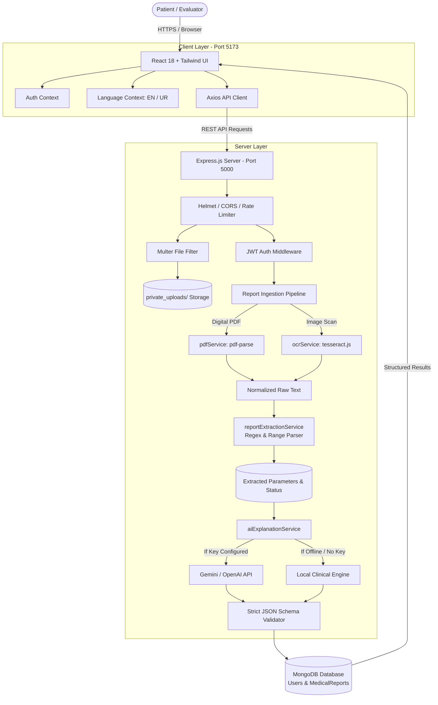

# MediExplain AI — AI Medical Report Explainer
### Capstone Academic Engineering Project (2026)

---

## 📋 Executive Abstract

Diagnostic laboratory reports play an indispensable role in patient care. However, patients frequently face significant anxiety and confusion due to medical jargon, complex reference intervals, metric abbreviations, and ambiguous abnormal flags. **MediExplain AI** is a full-stack educational healthcare web platform engineered to bridge this health communication gap.

The platform provides a secure, privacy-preserving workflow where authenticated users can upload medical laboratory reports in PDF or image format (PNG, JPEG). Leveraging a hybrid ingestion pipeline combining digital stream parsing (`pdf-parse`) and Optical Character Recognition (`tesseract.js`), the system extracts laboratory parameters, observed values, metric units, and laboratory-specific reference ranges. Extracted data is evaluated using objective boundary comparison logic and translated into simple, accessible educational explanations in both **English** and **Urdu** (with full right-to-left layout and Urdu typography). 

MediExplain AI incorporates a strict zero-hallucination policy: values and boundaries are drawn exclusively from extracted facts, and a verified local medical rule engine acts as an offline fallback when external LLM credentials (Google Gemini, OpenAI) are unavailable. Operating strictly as an educational tool rather than a diagnostic device, the application explicitly guides patients on relevant questions to ask their licensed physicians.

---

## 🎯 Problem Statement

1. **Jargon Barrier:** Patients receiving blood tests, metabolic panels, or complete blood counts (CBC) encounter terminology (e.g., HbA1c, ALT, Creatinine, MCV, BUN) without intuitive clinical meaning.
2. **Context-Free Reference Ranges:** Standard reference ranges vary by laboratory calibration, test methodology, patient age, and sex. Patients misinterpret any out-of-range value as severe pathology or self-diagnose prematurely.
3. **Language Barriers:** In multilingual regions like South Asia and the Middle East, lab reports are universally issued in English, leaving native Urdu and regional language speakers dependent on informal translations.
4. **Data Privacy in Digital Health:** Public consumer LLMs often expose sensitive health data to third-party model training. A privacy-first, locally-audited pipeline with secure non-public storage and cascade deletion rights is vital.

---

## 🚀 Objectives

- **Automated Parameter Extraction:** Accurately extract test names, values, units, and reference ranges from digital PDFs and scanned images.
- **Objective Range Comparison:** Compare values against ranges only when explicitly provided on the report; gracefully flag missing or non-numeric intervals as "unclear".
- **Bilingual Plain-Language Explanation:** Generate neutral summaries and patient-centric explanations in both English and Urdu with native RTL typography.
- **Zero-Hallucination & Offline Resiliency:** Deliver verified clinical explanations even when offline or without external AI API keys through a built-in medical rule engine.
- **Enterprise-Grade Security & Privacy:** Implement JWT authentication, HttpOnly cookies, private storage outside the web root, ownership access control, and 1-click permanent data wipe.

---

## 🌟 Key Features

| Category | Capability |
|---|---|
| **Document Ingestion** | Supports PDF, PNG, and JPEG files up to 10 MB with drag-and-drop and real-time upload pipeline states. |
| **Hybrid OCR Engine** | Direct digital stream text extraction for digital PDFs + Tesseract.js OCR for image scans. |
| **Medical Heuristic Parser** | Identifies CBC, Metabolic, Renal, Liver, Lipid, and Thyroid panels, normalizing OCR character streams. |
| **Bilingual Explanations** | Generates clear explanations in English and Urdu, toggled on demand without page reload. |
| **Physician Consultation Questions** | Synthesizes custom, relevant questions for patients to discuss during clinical consultations. |
| **Original Text Inspection** | Provides a collapsible raw-text viewer allowing users and clinicians to cross-verify extracted text. |
| **Offline Fallback Engine** | Built-in clinical knowledge base ensures 100% operational reliability for evaluators without API keys. |
| **Print & Export Support** | Clean, CSS-optimized print and PDF export layout for physical patient records. |
| **Security & Privacy** | Password hashing (`bcryptjs`), rate limiting, private storage outside web root, and cascade account wipe. |
| **1-Click Evaluator Demo** | Instant "Try Demo Report" button loads a synthetic fictional medical report with zero file uploads required. |

---

## 🛠 Technology Stack

### Frontend
- **Framework:** React 18
- **Build Tool:** Vite 6
- **Routing:** React Router DOM v6
- **Styling:** Tailwind CSS (custom medical SaaS palette: Navy `#0F172A`, Teal `#0D9488`, Sky `#0284C7`)
- **Typography:** Google Fonts (Inter for English; Noto Nastaliq Urdu & Noto Sans Arabic for Urdu RTL)
- **Icons:** Lucide React
- **HTTP Client:** Axios with credentials and session synchronization

### Backend
- **Runtime:** Node.js (v18+)
- **Framework:** Express.js 4 (REST API architecture)
- **Database:** MongoDB & Mongoose ORM
- **Authentication:** JSON Web Tokens (JWT) via HttpOnly cookies and Bearer headers
- **Password Security:** `bcryptjs` (salt rounds: 10)
- **File Uploads:** Multer with MIME and extension filtering to private storage
- **Security Middleware:** Helmet, CORS, and Express Rate Limit
- **Testing:** Node.js native test runner (`node:test`, `node:assert`) and Supertest

### Document & AI Processing
- **PDF Extraction:** `pdf-parse` (digital PDF text extraction)
- **Image OCR:** `tesseract.js` (browser & Node.js optical character recognition)
- **AI Services:** Pluggable connector supporting **Google Gemini API**, **OpenAI API**, and the **Local Clinical Fallback Engine**.

---

## 📐 System Architecture



---

## 📁 Folder Structure

```
AI medical Report Explaner/
├── package.json                   # Root workspace scripts (dev, test, build)
├── .gitignore                     # Git exclusions (node_modules, private_uploads, .env)
├── PLAN.md                        # Formal implementation plan & milestones
├── samples/
│   ├── generateSamplePdf.js       # Script generating test demo PDF
│   └── DEMO_Patient_Lab_Report.pdf# Synthetic evaluation document
├── client/
│   ├── index.html                 # Web fonts (Inter, Noto Nastaliq Urdu) & metadata
│   ├── package.json               # Client dependencies (React, Vite, Tailwind, Lucide)
│   ├── vite.config.js             # Vite configuration with /api backend proxy
│   ├── tailwind.config.js         # Tailwind palette and font definitions
│   ├── postcss.config.js          # PostCSS configuration
│   └── src/
│       ├── main.jsx               # Application entry point with providers
│       ├── App.jsx                # Route declarations & ProtectedRoute guards
│       ├── index.css              # Custom scrollbars, print rules, RTL helpers
│       ├── context/
│       │   ├── AuthContext.jsx    # Session state, login, register, logout
│       │   └── LanguageContext.jsx# Language toggle (English/Urdu) & translations
│       ├── services/
│       │   └── api.js             # Axios instance with credentials
│       ├── components/
│       │   ├── Navbar.jsx         # Navigation, language switch, user profile
│       │   ├── Footer.jsx         # Project declarations and medical links
│       │   ├── MedicalDisclaimer.jsx # Educational alert cards
│       │   ├── StatusBadge.jsx    # Normal, High, Low, Unclear color badges
│       │   ├── ResultsTable.jsx   # Tabular lab results with range visualizers
│       │   ├── LoadingSpinner.jsx # Real-time multi-stage pipeline loader
│       │   ├── ConfirmModal.jsx   # Deletion confirmation modal
│       │   └── StatCard.jsx       # Dashboard summary cards
│       └── pages/
│           ├── LandingPage.jsx    # Hero, 3-step guide, capabilities, FAQ
│           ├── LoginPage.jsx      # Authentication screen with error display
│           ├── RegisterPage.jsx   # Account creation with validation
│           ├── DashboardPage.jsx  # Overview metrics, recent reports, 1-click demo
│           ├── UploadPage.jsx     # Drag-and-drop, file validation, progress states
│           ├── ReportDetailsPage.jsx # Extracted facts, bilingual AI notes, doctor questions
│           ├── ReportHistoryPage.jsx # Searchable report timeline
│           ├── ProfilePage.jsx    # Name update, password change, account deletion
│           ├── AboutPage.jsx      # Project overview and technology breakdown
│           ├── PrivacyPage.jsx    # Data protection, non-public storage disclosure
│           └── DisclaimerPage.jsx # Detailed medical & educational limits
└── server/
    ├── package.json               # Backend dependencies & test scripts
    ├── .env.example               # Template environment configuration
    ├── .env                       # Local environment variables
    ├── private_uploads/           # Private secure uploaded files (non-public)
    ├── src/
    │   ├── server.js              # Application listener & DB connection
    │   ├── app.js                 # Express middleware & route bindings
    │   ├── config/
    │   │   └── db.js              # MongoDB connection via Mongoose
    │   ├── models/
    │   │   ├── User.js            # User authentication schema
    │   │   └── MedicalReport.js   # Laboratory report schema
    │   ├── middleware/
    │   │   ├── authMiddleware.js  # JWT verification via cookie or header
    │   │   ├── uploadMiddleware.js# Multer storage, size (10MB), and MIME checks
    │   │   ├── rateLimiter.js     # IP rate limiters for auth and uploads
    │   │   └── errorHandler.js    # Centralized clean error handling
    │   ├── controllers/
    │   │   ├── authController.js  # Register, login, logout, getMe
    │   │   ├── reportController.js# Upload, get, explain, delete, demo loader
    │   │   └── userController.js  # Profile update, password change, cascade wipe
    │   ├── routes/
    │   │   ├── authRoutes.js      # /api/auth endpoints
    │   │   ├── reportRoutes.js    # /api/reports endpoints
    │   │   └── userRoutes.js      # /api/users endpoints
    │   ├── services/
    │   │   ├── fileStorageService.js # Path-traversal safe deletion & access
    │   │   ├── pdfService.js      # pdf-parse digital PDF stream reader
    │   │   ├── ocrService.js      # Tesseract.js image OCR worker
    │   │   ├── reportExtractionService.js # Heuristic lab parameter regex parser
    │   │   └── aiExplanationService.js    # Gemini/OpenAI caller & clinical fallback
    │   └── utils/
    │       └── validators.js      # Registration and input validation
    └── tests/
        ├── extraction.test.js     # Range evaluation and regex tests
        ├── aiExplanation.test.js  # JSON schema and bilingual fallback tests
        └── api.test.js            # End-to-end integration tests (Auth, Reports, Files)
```

---

## ⚡ Installation & Setup Guide

### Prerequisites
- **Node.js**: v18.0.0 or higher (Tested on Node v24.15.0)
- **MongoDB**: Community Server running locally on default port `27017` (or MongoDB Atlas URI)
- **NPM**: v9 or higher

### 1. Clone or Open Workspace
```bash
cd "AI medical Report Explaner"
```

### 2. Backend Setup
1. Navigate to the server folder and verify configuration:
   ```bash
   cd server
   ```
2. Configure environment variables in `server/.env` (pre-configured defaults provided):
   ```env
   PORT=5000
   NODE_ENV=development
   MONGODB_URI=mongodb://127.0.0.1:27017/mediexplain_ai
   JWT_SECRET=mediexplain_ai_secure_jwt_token_development_key_college_2026
   JWT_EXPIRES_IN=7d
   FRONTEND_URL=http://localhost:5173
   LLM_PROVIDER=gemini
   LLM_API_KEY=
   LLM_MODEL=gemini-1.5-flash
   UPLOAD_DIR=private_uploads
   MAX_UPLOAD_SIZE_MB=10
   ```
   > **Note on AI Keys:** If `LLM_API_KEY` is left blank, the application automatically uses the **built-in verified clinical fallback engine**. Evaluators can test every feature without creating an external API account.

### 3. Frontend Setup
```bash
cd ../client
npm install
```

---

## 🚀 Running the Application

### Option A: Simultaneous Start (Recommended)
From the root workspace directory, you can start both the backend and frontend concurrently:
```bash
# Terminal 1 (Backend):
npm run server

# Terminal 2 (Frontend):
npm run client
```

### Option B: Individual Components
```bash
# Start Backend (Port 5000):
cd server
npm run dev

# Start Frontend (Port 5173):
cd client
npm run dev
```

Open your browser at: **`http://localhost:5173`**

---

## 🧪 Testing Suite & Automated Verification

The application includes an automated test suite covering unit logic and integration endpoints without requiring external API tokens or internet access.

Run the test suite:
```bash
cd server
npm test
```

### Verified Test Matrix (28 Tests Passing)
- [x] **Authentication:** User registration, duplicate email prevention, password mismatch validation.
- [x] **Login Security:** Valid login, invalid credentials generic error, JWT cookie & token issuance.
- [x] **Session Persistence:** `/api/auth/me` with valid/invalid tokens.
- [x] **Physical File Upload:** Multipart PDF upload, text extraction, laboratory evaluation.
- [x] **MIME & Size Restrictions:** Rejection of disallowed extensions (`.exe`, `.txt`).
- [x] **Heuristic Parser:** Bounded ranges (`min - max`), unbounded ranges (`< max`, `> min`), non-numeric handling.
- [x] **AI Schema Enforcer:** Strict JSON schema validation and error raising.
- [x] **Bilingual Clinical Engine:** English and Urdu explanation generation.
- [x] **Report Ownership:** User B access block to User A's private report (HTTP 403).
- [x] **Permanent File & Record Deletion:** Safe disk unlinking and MongoDB document removal.
- [x] **Cascade Account Deletion:** Wipe of user record, reports, and binary files.

---

## 📡 REST API Documentation

### Authentication (`/api/auth`)
| Method | Endpoint | Access | Description |
|---|---|---|---|
| `POST` | `/api/auth/register` | Public | Register user (`name`, `email`, `password`, `confirmPassword`). |
| `POST` | `/api/auth/login` | Public | Authenticate user and issue HttpOnly cookie & token. |
| `POST` | `/api/auth/logout` | Public | Invalidate auth cookie. |
| `GET` | `/api/auth/me` | Private | Retrieve current user profile. |

### Reports (`/api/reports`)
| Method | Endpoint | Access | Description |
|---|---|---|---|
| `POST` | `/api/reports/upload` | Private | Upload file (`reportFile`), run extraction & explanation pipeline. |
| `POST` | `/api/reports/sample-demo` | Private | Instantly load synthetic demonstration report. |
| `GET` | `/api/reports` | Private | List all reports belonging to the authenticated user. |
| `GET` | `/api/reports/:id` | Private | Fetch detailed report (enforces strict ownership check). |
| `POST` | `/api/reports/:id/explain`| Private | Generate or retrieve explanation in selected language (`Urdu`/`English`). |
| `DELETE`| `/api/reports/:id` | Private | Permanently delete report and unlinks file from disk. |

### User Profile (`/api/users`)
| Method | Endpoint | Access | Description |
|---|---|---|---|
| `GET` | `/api/users/profile` | Private | Get profile details and total report counts. |
| `PATCH` | `/api/users/profile` | Private | Update user display name. |
| `PATCH` | `/api/users/password` | Private | Change password with current password verification. |
| `DELETE`| `/api/users/account` | Private | Cascade delete account, associated reports, and storage files. |

---

## 🔒 Security & Privacy Architecture

1. **Storage Isolation:** Uploaded documents are saved in `server/private_uploads/`, located outside the public web root. Direct HTTP access to raw medical files is completely prevented.
2. **Access Control:** Every report query verifies `report.userId === req.user._id`. Passing another user's ID yields an HTTP 403 Forbidden.
3. **Data Sanitization:** File names are replaced with random hexadecimal hashes upon upload to eliminate path-traversal vulnerabilities.
4. **Token Security:** JWT tokens are issued via `HttpOnly`, `SameSite: Lax` cookies with fallback support for Authorization Bearer headers.
5. **Zero-Trace Logging:** Raw patient identifiers, passwords, and full medical sheets are never written to server console logs.
6. **Data Minimization:** Only extracted numerical values, test names, and reference ranges are transmitted to configured AI providers.

---

## 🩺 Clinical Logic & Ethical Guardrails

- **No Diagnostic Labels:** Results are categorized strictly as `Within Range`, `Above Range`, `Below Range`, or `Unclear`. Out-of-range values are never described as definitive diseases.
- **Handling Missing Boundaries:** When a test lacks a reference range on the uploaded document, the status is explicitly set to `unclear` with an explanatory note. The system never invents ranges.
- **No Treatment Recommendations:** The platform never outputs medication prescriptions, pharmacological dosages, or intervention schedules.
- **Language Fidelity:** Laboratory test names and metric units remain standard (e.g., `mg/dL`, `g/dL`) to ensure cross-verification against physical sheets.

---

## 🎓 Evaluator Walkthrough (5-Minute Demo)

1. **Visit Landing Page:** Navigate to `http://localhost:5173`. Review the medical SaaS design, 3-step workflow, and language toggle.
2. **Register or Sign In:** Click "Register" and create an account (e.g., `sarah@example.com` / `Password123!`).
3. **Explore Dashboard:** Observe the user statistics, guideline cards, and empty state.
4. **Instant 1-Click Demo:** Click **"Try Demo Report"** on the dashboard. The system instantly loads synthetic laboratory data (CBC and Metabolic Panel) without needing a local file.
5. **Inspect Results:**
   - Review the categorized pills (Within Range: Platelets, Creatinine, BUN; Above Range: Glucose, WBC, Cholesterol; Below Range: Hemoglobin).
   - Review the plain-language clinical explanation.
   - Toggle language to **اردو (Urdu)** to see readable RTL Urdu text.
   - Expand the **"Original Extracted Raw Text"** drawer.
   - Click **"Print / PDF"** to preview the print-ready patient sheet.
6. **Upload Custom Document:**
   - Navigate to **"Upload Report"**.
   - Upload the generated test document located at:
     `samples/DEMO_Patient_Lab_Report.pdf`
   - Observe the real-time processing states (Uploading ➔ Extracting ➔ Analyzing ➔ Completed).
7. **Report History & Permanent Deletion:**
   - Go to **"Report History"**, search for reports, and delete a report to verify secure file deletion.
8. **Profile & Cascade Deletion:**
   - Navigate to **"Profile & Settings"**, inspect account metrics, update your name, or test account cascade deletion.

---

## ⚠️ Known Limitations & Future Roadmap

### Limitations
- **Severely Degraded Images:** Heavily wrinkled, blurry, or low-contrast mobile camera photos may introduce OCR character inaccuracies.
- **Tabular Alignment in Multi-Column Scans:** Complex multi-column layouts with mixed languages require high-resolution input for optimal heuristic segmentation.

### Future Roadmap
- Integration of DICOM medical imaging viewers (e.g., X-ray / CT scan metadata).
- Expanded regional language support (Hindi, Arabic, Bengali, Punjabi).
- Direct secure FHIR/HL7 electronic health record (EHR) export options.

---

## 📜 Academic Integrity & License

This project was developed strictly for academic evaluation and educational demonstration. It is released under the **ISC License**.

*MediExplain AI Team &bull; 2026*
